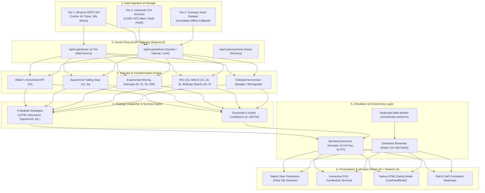
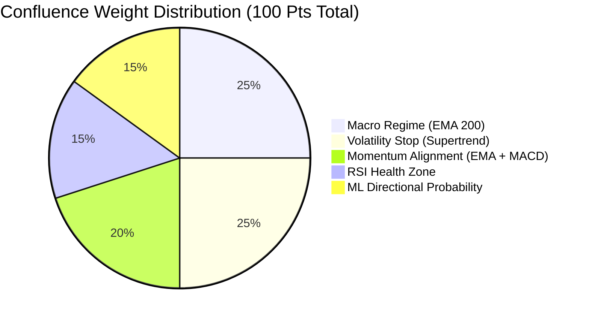
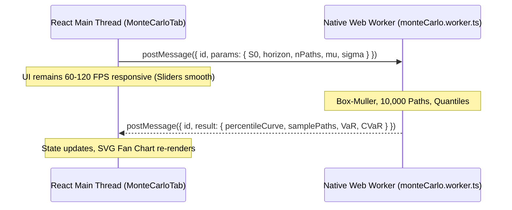

# 🏛️ Quantitative System Architecture & Mathematical Specification

> **System Name**: Bitcoin Research & Quantitative Trading Lab  
> **Architecture Version**: 5.2.1 PRO  
> **Document Status**: Official Architecture & Mathematical Reference  
> **Workspace**: `/mnt/data/BACK_UP/Code/Quant_Trading_System`

---

## 📑 Table of Contents
1. [System Overview & Architectural Layers](#1-system-overview--architectural-layers)
2. [Multi-Tier Data Ingestion Pipeline](#2-multi-tier-data-ingestion-pipeline)
3. [Mathematical Formulations of Technical Indicators](#3-mathematical-formulations-of-technical-indicators)
4. [Quantitative Trading Strategy Engine](#4-quantitative-trading-strategy-engine)
5. [Ensemble Multi-Factor Confluence Scoring Model](#5-ensemble-multi-factor-confluence-scoring-model)
6. [Vectorized Backtest Engine & Risk Mechanics](#6-vectorized-backtest-engine--risk-mechanics)
7. [Monte Carlo Stochastic Engine (Web Worker Concurrency)](#7-monte-carlo-stochastic-engine-web-worker-concurrency)
8. [Interactive SVG Charting & HUD Rendering](#8-interactive-svg-charting--hud-rendering)
9. [Modern Web Platform Principles (Baseline)](#9-modern-web-platform-principles-baseline)

---

## 1. System Overview & Architectural Layers

The system is constructed as a decoupled, reactive single-page quantitative laboratory. It bridges complex multi-asset quantitative models with a high-framerate modern web user interface:



---

## 2. Multi-Tier Data Ingestion Pipeline

To ensure **zero-downtime reliability** across diverse network environments (corporate proxies, sandboxes, or offline research), market data is loaded via a 3-tier cascade:

```
Request Market Data
   ├── Tier 1 (Online): Binance Live REST API (Timeout: 2,000ms)
   │     └── On Success: Cache in-memory (Ticker: 8s, Klines: 30s)
   │
   ├── Tier 2 (Offline Archive): Local Multi-Year CSV Files
   │     └── `trading_data/<SYMBOL>_trading_data.csv` (Parsed in < 2ms)
   │
   └── Tier 3 (Deterministic Seed): `RAW_BTC_SEEDS` in `historicalData.ts`
         └── Populated with `calculateIndicators()` for instant initial render
```

### Supported Asset Universe
The system natively indexes daily OHLCV historical series for 5 major crypto assets:
- **BTC**: 4,263 bars (2014–2026)
- **ETH**: 3,114 bars (2017–2026)
- **SOL**: 2,231 bars (2020–2026)
- **BNB**: 3,114 bars (2017–2026)
- **ADA**: 3,114 bars (2017–2026)

---

## 3. Mathematical Formulations of Technical Indicators

All quantitative transformations in [`src/utils/technicalIndicators.ts`](file:///mnt/data/BACK_UP/Code/Quant_Trading_System/src/utils/technicalIndicators.ts) are implemented in pure TypeScript without external black-box libraries.

### 3.1. Wilder's Average True Range (ATR)
True Range ($TR_t$) measures market volatility considering intra-day range and previous close gaps:
$$TR_t = \max\left( H_t - L_t, \, |H_t - C_{t-1}|, \, |L_t - C_{t-1}| \right)$$

For the initial $N$ periods ($N = 10$):
$$ATR_N = \frac{1}{N} \sum_{i=1}^{N} TR_i$$

For subsequent periods $t > N$, Wilder's smoothing algorithm is applied recursively:
$$ATR_t = \frac{ATR_{t-1} \times (N - 1) + TR_t}{N}$$

---

### 3.2. Supertrend ATR Trailing Stop
The Supertrend indicator calculates adaptive volatility bands based on the median price ($HL_2$) and scaled ATR:
$$HL_{2,t} = \frac{H_t + L_t}{2}$$
$$\text{Basic Upper}_t = HL_{2,t} + (\text{multiplier} \times ATR_t)$$
$$\text{Basic Lower}_t = HL_{2,t} - (\text{multiplier} \times ATR_t)$$

where $\text{period} = 10$ and $\text{multiplier} = 3.0$.

#### Band Hysteresis & Direction State Machine
To prevent whipsaws in ranging markets, bands trail price non-linearly:
$$\text{Final Upper}_t = \begin{cases} \text{Basic Upper}_t & \text{if } \text{Basic Upper}_t < \text{Final Upper}_{t-1} \text{ or } C_{t-1} > \text{Final Upper}_{t-1} \\ \text{Final Upper}_{t-1} & \text{otherwise} \end{cases}$$

$$\text{Final Lower}_t = \begin{cases} \text{Basic Lower}_t & \text{if } \text{Basic Lower}_t > \text{Final Lower}_{t-1} \text{ or } C_{t-1} < \text{Final Lower}_{t-1} \\ \text{Final Lower}_{t-1} & \text{otherwise} \end{cases}$$

$$\text{Direction}_t = \begin{cases} +1 \text{ (Bullish)} & \text{if } \text{Direction}_{t-1} = -1 \land C_t > \text{Final Upper}_t \\ -1 \text{ (Bearish)} & \text{if } \text{Direction}_{t-1} = +1 \land C_t < \text{Final Lower}_t \\ \text{Direction}_{t-1} & \text{otherwise} \end{cases}$$

$$\text{Supertrend}_t = \begin{cases} \text{Final Lower}_t & \text{if } \text{Direction}_t = +1 \\ \text{Final Upper}_t & \text{if } \text{Direction}_t = -1 \end{cases}$$

---

### 3.3. Exponential Moving Averages (EMA)
For any smoothing length $N \in \{9, 21, 50, 200\}$:
$$k = \frac{2}{N + 1}$$
$$EMA_{t} = C_t \times k + EMA_{t-1} \times (1 - k)$$

---

### 3.4. Moving Average Convergence Divergence (MACD)
$$\text{MACD Line}_t = EMA_{12}(C)_t - EMA_{26}(C)_t$$
$$\text{Signal Line}_t = EMA_{9}(\text{MACD Line})_t$$
$$\text{MACD Histogram}_t = \text{MACD Line}_t - \text{Signal Line}_t$$

---

### 3.5. Relative Strength Index (RSI)
Over lookback window $N = 14$:
$$\Delta C_t = C_t - C_{t-1}$$
$$\text{Gain}_t = \max(\Delta C_t, 0), \quad \text{Loss}_t = \max(-\Delta C_t, 0)$$

Using Wilder's exponential smoothing:
$$\text{AvgGain}_t = \frac{\text{AvgGain}_{t-1} \times 13 + \text{Gain}_t}{14}, \quad \text{AvgLoss}_t = \frac{\text{AvgLoss}_{t-1} \times 13 + \text{Loss}_t}{14}$$
$$RS_t = \frac{\text{AvgGain}_t}{\text{AvgLoss}_t}, \quad RSI_t = 100 - \left( \frac{100}{1 + RS_t} \right)$$

---

### 3.6. Bollinger Bands
Over window $N = 20$ with $K = 2$ standard deviations:
$$\mu_t = \frac{1}{20}\sum_{i=0}^{19} C_{t-i}, \quad \sigma_t = \sqrt{\frac{1}{20}\sum_{i=0}^{19} (C_{t-i} - \mu_t)^2}$$
$$BB_{\text{upper}} = \mu_t + 2\sigma_t, \quad BB_{\text{lower}} = \mu_t - 2\sigma_t, \quad BB_{\text{position}} = \frac{C_t - BB_{\text{lower}}}{BB_{\text{upper}} - BB_{\text{lower}}}$$

---

## 4. Quantitative Trading Strategy Engine

The strategy dispatcher in [`src/utils/strategy.ts`](file:///mnt/data/BACK_UP/Code/Quant_Trading_System/src/utils/strategy.ts) evaluates signals on each bar:

| Strategy ID | Model Key | Signal Logic | Exit Condition |
|---|---|---|---|
| **Ensemble Confluence** | `ensemble` | Confluence Score $\ge 70$ | Score $< 40$ or Macro Breakdown ($C < EMA_{200} \land ST_{dir} = -1$) |
| **LSTM Directional** | `lstm` | Probability $P(\text{up}) \ge \text{threshold}$ (default: $0.51$) | $P(\text{up}) < \text{threshold}$ |
| **Astronacci Cycle** | `astronacci` | Lunar Apogee Window ($t \pmod{27} \in \{3,4\}$) $\land (RSI < 48 \lor \text{Hist} > 0)$ | Outside Apogee $\land RSI > 65$ |
| **Supertrend ATR Stop** | `supertrend` | $\text{Direction}_t = +1$ ($C_t > \text{Supertrend}$) | $\text{Direction}_t = -1$ ($C_t < \text{Supertrend}$) |
| **EMA Crossover** | `ema_cross` | $EMA_9 > EMA_{21}$ (Golden Cross) | $EMA_9 < EMA_{21}$ (Death Cross) |
| **Trend-Filtered Momentum** | `trend_filter` | $C_t > EMA_{200}$ (Macro Bull) $\land EMA_9 > EMA_{21}$ | $C_t < EMA_{200} \lor EMA_9 < EMA_{21}$ |
| **RSI Reversal** | `rsi_reversal` | $RSI < 35$ (Oversold Mean Reversion) | $RSI > 65$ (Overbought Extension) |
| **Bollinger Breakout** | `bb_breakout` | $C_t > BB_{\text{mid}} \land BB_{\text{position}} > 0.5$ | $C_t < BB_{\text{mid}}$ |
| **MACD Crossover** | `macd_cross` | $\text{MACD Line} > \text{Signal Line}$ | $\text{MACD Line} < \text{Signal Line}$ |

---

## 5. Ensemble Multi-Factor Confluence Scoring Model

The **Ensemble Strategy** computes a continuous confluence score ($S \in [0, 100]$) aggregated across 5 independent market dimensions:



### Scoring Mathematical Breakdown:
$$S_t = w_{\text{macro}} + w_{\text{volatility}} + w_{\text{momentum}} + w_{\text{rsi}} + w_{\text{ml}}$$

1. **Macro Trend Regime ($w_{\text{macro}} \in \{0, 25\}$)**:
   $$w_{\text{macro}} = \begin{cases} 25 & \text{if } C_t > EMA_{200,t} \\ 0 & \text{otherwise} \end{cases}$$

2. **Volatility Trailing Stop ($w_{\text{volatility}} \in \{0, 25\}$)**:
   $$w_{\text{volatility}} = \begin{cases} 25 & \text{if } \text{Direction}_t = +1 \text{ (Supertrend Bullish)} \\ 0 & \text{otherwise} \end{cases}$$

3. **Momentum Alignment ($w_{\text{momentum}} \in [0, 20]$)**:
   $$w_{\text{ema\_fast}} = \begin{cases} 10 & \text{if } EMA_{9,t} > EMA_{21,t} \\ 0 & \text{otherwise} \end{cases}$$
   $$w_{\text{macd}} = \begin{cases} 10 & \text{if } \text{Hist}_t > 0 \lor \text{MACD}_t > \text{Signal}_t \\ 0 & \text{otherwise} \end{cases}$$
   $$w_{\text{momentum}} = w_{\text{ema\_fast}} + w_{\text{macd}}$$

4. **RSI Expansion Health Zone ($w_{\text{rsi}} \in [0, 15]$)**:
   $$w_{\text{rsi}} = \begin{cases} 15 & \text{if } 40 \le RSI_t \le 65 \text{ (Healthy trend)} \\ 8 & \text{if } 65 < RSI_t \le 75 \text{ (Strong momentum)} \\ 0 & \text{otherwise (Oversold dump or extreme bubble)} \end{cases}$$

5. **Machine Learning Probability ($w_{\text{ml}} \in [0, 15]$)**:
   $$w_{\text{ml}} = \begin{cases} 15 & \text{if } P(\text{up}) \ge 0.52 \\ 8 & \text{if } 0.50 \le P(\text{up}) < 0.52 \\ 0 & \text{otherwise} \end{cases}$$

---

## 6. Vectorized Backtest Engine & Risk Mechanics

The backtest simulator in [`src/components/BacktestTab.tsx`](file:///mnt/data/BACK_UP/Code/Quant_Trading_System/src/components/BacktestTab.tsx) models real execution frictions:

### 6.1. Order Execution & Cash Flow Mechanics
- **Account Model**: Single-position spot simulation.
- **Transaction Fee**: Fixed rate $f = 0.001$ ($0.1\%$ per order fill).

#### Entry Execution (BUY)
When cash balance $B_{\text{cash}} > 0$ and signal triggers:
$$\text{Cost Basis} = B_{\text{cash}}$$
$$\text{Fee}_{\text{entry}} = \text{Cost Basis} \times f$$
$$\text{Units Acquired} = \frac{\text{Cost Basis} - \text{Fee}_{\text{entry}}}{C_t}$$
$$B_{\text{cash}} = 0$$

#### Exit Execution (SELL)
When holding position units $U > 0$ and exit condition or Stop-Loss / Take-Profit triggers:
$$\text{Gross Proceeds} = U \times C_t$$
$$\text{Fee}_{\text{exit}} = \text{Gross Proceeds} \times f$$
$$B_{\text{cash}} = \text{Gross Proceeds} - \text{Fee}_{\text{exit}}$$
$$\text{PnL} = B_{\text{cash}} - \text{Cost Basis}$$
$$\text{Return}_{\%} = \left( \frac{\text{PnL}}{\text{Cost Basis}} \right) \times 100\%$$

---

### 6.2. Quantitative Risk Metrics & Performance KPIs

#### Sharpe Ratio (Annualized)
Evaluates excess return per unit of volatility relative to risk-free rate $R_f \approx 0$:
$$\text{Sharpe} = \frac{\overline{R_{\text{daily}}} - R_{f}}{\sigma_{\text{daily}}} \times \sqrt{365}$$

#### Profit Factor
$$\text{Profit Factor} = \frac{\sum \text{Gains}_{\text{profitable trades}}}{\sum |\text{Losses}_{\text{losing trades}}|}$$

#### Maximum Drawdown (MDD)
Tracks peak-to-trough equity deterioration over time:
$$\text{Peak}_t = \max_{i \le t} \text{Equity}_i$$
$$\text{Drawdown}_t = \frac{\text{Peak}_t - \text{Equity}_t}{\text{Peak}_t} \times 100\%$$
$$\text{MDD} = \max_{t} \text{Drawdown}_t$$

---

## 7. Monte Carlo Stochastic Engine (Web Worker Concurrency)

To model future asset price uncertainty over a forecast horizon $T \in [7, 60]$ days, the platform implements a Geometric Brownian Motion (GBM) stochastic projection in [`src/workers/monteCarloCore.ts`](file:///mnt/data/BACK_UP/Code/Quant_Trading_System/src/workers/monteCarloCore.ts).

### 7.1. Stochastic Differential Equation (SDE)
Under the Black-Scholes-Merton framework:
$$dS_t = \mu S_t dt + \sigma S_t dW_t$$

Using Itô's Lemma, the exact discrete simulation solution is:
$$S_{t + \Delta t} = S_t \exp\left( \left(\mu - \frac{1}{2}\sigma^2\right)\Delta t + \sigma \sqrt{\Delta t} \, Z \right)$$

where:
- $\mu$: Daily drift rate ($\frac{\text{dailyDriftPct}}{100}$)
- $\sigma$: Daily volatility ($\frac{\text{dailyVolPct}}{100}$)
- $\Delta t = 1.0$ day
- $Z \sim \mathcal{N}(0, 1)$: Standard Gaussian random variable generated via the **Box-Muller Transform**:
  $$Z = \sqrt{-2 \ln(U_1)} \cos(2\pi U_2), \quad U_1, U_2 \sim \mathcal{U}(0, 1)$$

---

### 7.2. Value at Risk (VaR) & Expected Shortfall (CVaR)
For $M \in [1000, 10000]$ simulation paths sorted in ascending order of terminal price:
$$S_T^{(1)} \le S_T^{(2)} \le \dots \le S_T^{(M)}$$

1. **Value at Risk ($\text{VaR}_{95\%}$)**:
   Measures maximum projected percentage loss at the 5th percentile:
   $$\text{VaR}_{95\%} = \max\left(0, \, \frac{S_0 - S_T^{(\lfloor 0.05 M \rfloor)}}{S_0} \times 100\%\right)$$

2. **Conditional Value at Risk ($\text{CVaR}_{95\%}$ / Expected Shortfall)**:
   Measures expected severity of tail losses beyond the VaR threshold:
   $$\text{CVaR}_{95\%} = \max\left(0, \, \frac{S_0 - \frac{1}{K}\sum_{i=1}^{K} S_T^{(i)}}{S_0} \times 100\%\right), \quad K = \lfloor 0.05 M \rfloor$$

---

### 7.3. Concurrency Thread Architecture
The stochastic engine executes strictly inside a **Dedicated Web Worker** ([`src/workers/monteCarlo.worker.ts`](file:///mnt/data/BACK_UP/Code/Quant_Trading_System/src/workers/monteCarlo.worker.ts)), guaranteeing that 600,000+ stochastic floating-point operations never block the browser's UI thread:



---

## 8. Interactive SVG Charting & HUD Rendering

The candlestick terminal in [`src/components/CandlestickChart.tsx`](file:///mnt/data/BACK_UP/Code/Quant_Trading_System/src/components/CandlestickChart.tsx) renders directly via hardware-accelerated inline SVG:
- **Zero Charting Libraries**: Eliminates heavy dependencies (e.g. TradingView, Lightweight Charts) to keep bundle size under 420 KB.
- **Segmented Supertrend Paths**: Renders independent color-coded vector lines (`#10b981` Bull / `#f43f5e` Bear) calculated per-candle.
- **Dynamic Coordinate Transform**:
  $$x_i = \text{padding}_{\text{left}} + (i + 0.5) \times \left( \frac{\text{width} - \text{padding}_{\text{left}} - \text{padding}_{\text{right}}}{N_{\text{visible}}} \right)$$
  $$y(p) = \text{height} - \text{padding}_{\text{bottom}} - \left( \frac{p - p_{\min}}{p_{\max} - p_{\min}} \right) \times \text{effectiveHeight}$$

---

## 9. Modern Web Platform Principles (Baseline)

In conformance with **Google Chrome's Modern Web Guidance**, the application leverages native browser primitives:

1. **Native HTML `<dialog>` with `::backdrop`**:
   [`LiveFeedModal.tsx`](file:///mnt/data/BACK_UP/Code/Quant_Trading_System/src/components/LiveFeedModal.tsx) uses `.showModal()`, automatically gaining Top Layer elevation, native focus-trapping, and accessible `Escape` key handling.
2. **Native View Transitions API**:
   [`App.tsx`](file:///mnt/data/BACK_UP/Code/Quant_Trading_System/src/App.tsx) uses `document.startViewTransition()` to provide smooth cross-fade navigation between tabs with zero CSS library overhead.
3. **On-Demand Manual Sync (Anti-Polling Architecture)**:
   Avoids network congestion and console abort error spam by using user-initiated manual refreshes and server-side memory caching.
4. **CSS Container Queries (`@container`)**:
   Responsive visualizers dynamically adapt layout to parent element bounding boxes.

---

*Document maintained by Quant Trading System Core Engineering.*
