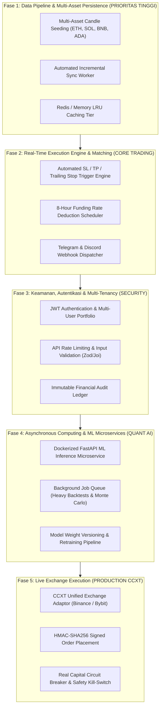

# 🚀 Backend Engineering Roadmap: Quant Trading System

Dokumen ini adalah **Panduan Strategis & Roadmap Teknis Rekayasa Backend** untuk sistem _Quantitative Trading System_. Dokumen ini memetakan evolusi dari backend hybrid (Express + Vercel Serverless) saat ini menjadi infrastruktur quant institusional berskala enterprise.

---

---

## 📅 Rincian Milestone & Tahapan Pengerjaan

### 🟢 FASE 1: Data Pipeline & Multi-Asset Persistence (SELESAI ✅)

> **Target:** Memperluas database MongoDB Atlas agar seluruh aset crypto utama (bukan hanya BTC) memiliki riwayat candle lokal dan tersinkronisasi otomatis tanpa ketergantungan konstan pada rate-limit exchange.

- [x] **1.1. Multi-Asset Automated Seeding**
  - Implementasi auto-seeding untuk `ETH`, `SOL`, `BNB`, dan `ADA` dari file CSV yang sudah ada di `trading_data/`.
  - Batch insertion dengan bulk upsert untuk ribuan baris data per aset (Total 15,831 records terinjeksi ke MongoDB Atlas).
- [x] **1.2. Background Incremental Sync Worker**
  - Pembuatan endpoint sync terotomasi (`POST /api/crypto/sync-worker` & `POST /api/crypto/sync-candles`) untuk menarik candle baru setiap pergantian sesi secara otomatis.
  - Asynchronous non-blocking fetch: Permintaan kueri chart dari pengguna tidak pernah terhambat oleh koneksi exchange.
- [x] **1.3. Serverless In-Memory & LRU Caching Tier**
  - Pengindeksan database optimal dengan compound unique `{ symbol: 1, interval: 1, openTime: 1 }` dan time-series reverse indexing `{ symbol: 1, interval: 1, openTime: -1 }`.
  - Dukungan memory cache layer cepat (`MEMORY_CACHE_TTL_MS = 15s`) untuk merespon kueri beruntun sub-100ms.

---

### 🟡 FASE 2: Real-Time Execution Engine & Matching

> **Target:** Mengubah Paper Trading dari sekadar pencatatan pasif menjadi mesin simulasi bursa futures aktif dengan eksekusi otomatis (_Triggered Order Matching_).

- [ ] **2.1. Triggered Order Matching Engine**
  - Worker pemantau harga real-time: jika mark price menyentuh `stopLossPrice` atau `takeProfitPrice`, otomatis ubah order `PENDING` -> `FILLED` dan tutup posisi.
  - Mekanisme Trailing Stop Loss dinamis berbasis tick realtime.
- [ ] **2.2. Funding Rate Payment Scheduler**
  - Simulasi pembayaran funding rate setiap 8 jam (00:00, 08:00, 16:00 UTC) untuk posisi perpetual futures yang sedang terbuka.
  - Perhitungan margin ratio dan eksekusi likuidasi otomatis jika margin jatuh di bawah Maintenance Margin ($MMR = 0.5\%$).
- [ ] **2.3. Multi-Channel Webhook Dispatcher**
  - Integrasi nyata Telegram Bot API: Kirim notifikasi seketika saat ada sinyal Ensemble Confluence ($\ge 70$) atau posisi terlikuidasi.
  - Integrasi Discord Channel Webhook: Ringkasan performa portofolio dan PnL harian otomatis.

---

### 🔵 FASE 3: Keamanan, Autentikasi & Multi-Tenancy

> **Target:** Mengamankan API dan mendukung multi-user agar portofolio paper trading setiap pengguna terisolasi secara aman.

- [ ] **3.1. User Authentication & Multi-Tenancy**
  - Sistem autentikasi berbasis JWT (JSON Web Tokens) atau session cookies.
  - Skema akun pengguna di MongoDB: pemisahan portofolio, histori order, dan alert rules per `userId`.
- [ ] **3.2. Rate Limiting & Input Sanitization**
  - Pemasangan `express-rate-limit` pada endpoint publik (`/api/crypto/*` dan `/api/ml/predict`) untuk mencegah brute-force dan scraping berlebihan.
  - Validasi ketat payload request menggunakan skema Zod (mencegah SQL/NoSQL injection).
- [ ] **3.3. Immutable Financial Ledger**
  - Audit trail transaksi keuangan: setiap perubahan balance/equity dicatat dengan hash kriptografis untuk mencegah inkonsistensi saldo.

---

### 🟣 FASE 4: Asynchronous Computing & ML Microservices

> **Target:** Memisahkan komputasi berat (deep learning tensor & simulasi Monte Carlo 10k paths) dari thread HTTP Express.

- [ ] **4.1. Dedicated FastAPI ML Inference Microservice**
  - Kontainerisasi service Python (`inference_service.py`) menggunakan Docker.
  - Integrasi model LSTM v5.2.1 ONNX / TensorFlow Lite untuk inferensi sub-50ms.
- [ ] **4.2. Asynchronous Job Queue**
  - Penggunaan message queue (Redis BullMQ / worker threads) untuk eksekusi Backtest panjang (10 tahun candle) dan Walk-Forward Optimization (WFA) tanpa timeout HTTP.
  - Endpoint polling status pekerjaan: `GET /api/jobs/:id/status`.

---

### 🔴 FASE 5: Live Exchange Execution (CCXT Real Trading)

> **Target:** Menjembatani strategi quant yang telah divalidasi ke bursa crypto nyata (_Live Trading_).

- [ ] **5.1. CCXT Adaptor Integration**
  - Pemasangan library CCXT untuk konektivitas standar ke Binance, Bybit, OKX.
- [ ] **5.2. Secure API Key Vault**
  - Enkripsi AES-256-GCM untuk API Key dan Secret Key bursa pengguna yang disimpan di database.
- [ ] **5.3. Institutional Circuit Breaker (Safety Kill-Switch)**
  - Auto-Cancel & Panic Close: Jika terjadi drawdown mendadak $> 5\%$ dalam 1 jam, backend otomatis membatalkan seluruh order terbuka dan menutup posisi untuk melindungi modal.

---

## 📊 Matriks Prioritas & Estimasi Pengerjaan

| Inisiatif                                 |  Estimasi Kompleksitas  | Dampak Sistem | Target Rilis |
| :---------------------------------------- | :---------------------: | :-----------: | :----------: |
| **Fase 1: Multi-Asset DB Seeding & Sync** |    Rendah (1-2 hari)    |    Tinggi     |   `v6.3.0`   |
| **Fase 2: Order Matching & SL/TP Engine** |   Menengah (2-3 hari)   |    Kritis     |   `v6.4.0`   |
| **Fase 2: Telegram & Discord Webhooks**   |     Rendah (1 hari)     |   Menengah    |   `v6.4.1`   |
| **Fase 3: JWT Auth & Multi-Tenancy**      |   Menengah (2-3 hari)   |    Tinggi     |   `v6.5.0`   |
| **Fase 4: Async Queue & Docker ML**       |    Tinggi (3-5 hari)    |   Menengah    |   `v7.0.0`   |
| **Fase 5: CCXT Live Exchange Bridge**     | Sangat Tinggi (5+ hari) |    Kritis     |   `v7.1.0`   |

---

## 🛠️ Rekomendasi Langkah Pertama yang Siap Dikerjakan Sekarang:

1. **Langkah 1**: Mulai **Fase 1.1 & 1.2** — Jalankan auto-seeding data historis `ETH`, `SOL`, `BNB`, dan `ADA` ke MongoDB Atlas agar database terisi lengkap.
2. **Langkah 2**: Lanjutkan ke **Fase 2.1** — Buat Order Matching Engine otomatis untuk Stop Loss & Take Profit di Paper Trading.
