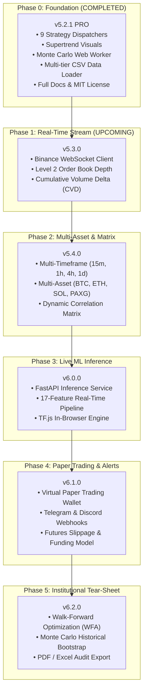

# 🗺️ Product Roadmap: Bitcoin Quantitative Trading System

This document outlines the strategic milestones, architectural evolutions, and engineering priorities for the **Bitcoin Research & Quantitative Trading Lab**.

---

## 🧭 Vision & Architectural Direction

Our mission is to evolve this platform from an interactive analytical research dashboard into a comprehensive, **production-grade quantitative terminal and algorithmic trading suite** that combines:
1. Multi-factor mathematical indicators and planetary cycle confluence (Astronacci).
2. Deep learning directional models (LSTM v5.2.1).
3. Non-blocking client-side computing (Web Workers, Native View Transitions).
4. High-frequency streaming market feeds and institutional risk analytics.

---

## 📌 Milestone Roadmap

### ✅ Phase 0: Core Foundation & Analytical Engine (`v5.2.1 PRO`) — *Completed*
- [x] **Ensemble Confluence Strategy (0–100 pts)** combining Trend, Volatility, Momentum, RSI, and ML signals.
- [x] **Supertrend Volatility Trailing Stop**: Segmented SVG pathing, dynamic flip buy/sell signal markers, and HUD readout.
- [x] **Monte Carlo Stochastic Engine via Web Worker**: Background thread execution of 10,000 paths (zero UI frame drop).
- [x] **Modern Web Standards**: Native View Transitions API and HTML `<dialog>` with top-layer focus trapping.
- [x] **High-Capacity Dataset**: Dynamic server CSV loader (4,200+ historical bars) replacing hardcoded data arrays.
- [x] **Comprehensive Documentation**: [`ARCHITECTURE.md`](ARCHITECTURE.md), [`DEPLOYMENT.md`](DEPLOYMENT.md), [`AGENT.md`](AGENT.md), [`CHANGELOG.md`](CHANGELOG.md), [`CONTRIBUTING.md`](CONTRIBUTING.md), [`LICENSE`](LICENSE).
- [x] **CI Pipeline**: Automated lint, test, and build GitHub Actions workflow (`.github/workflows/ci.yml`).

---

### 🚀 Phase 1: Real-Time Data Streaming & WebSocket Engine (`v5.3.0`) — *In Progress*
*Goal: Transition from manual REST polling to continuous, sub-second market data synchronization.*
- [ ] **Native Binance WebSocket Client**:
  - Direct connection to `wss://stream.binance.com:9443/ws/btcusdt@trade` and `@kline_1m`.
  - Automatic reconnection logic, heartbeat ping/pong, and error backoff.
- [ ] **Level 2 Order Book Depth Visualizer**:
  - Live 20-level bid/ask order book depth chart.
  - Dynamic bid-ask spread and liquidity imbalance ratio calculation.
- [ ] **Cumulative Volume Delta (CVD)**:
  - Real-time separation of market taker buy volume vs. taker sell volume to spot institutional absorption.

---

### 🌐 Phase 2: Multi-Timeframe & Multi-Asset Universe (`v5.4.0`)
*Goal: Expand research versatility across resolutions and liquid crypto instruments.*
- [ ] **Multi-Timeframe Engine**:
  - Dynamic dropdown selector (`15m`, `1h`, `4h`, `1d`, `1w`).
  - Resampling and aggregation utility for intra-day candlestick bars.
- [ ] **Multi-Asset Universe Support**:
  - Support for `ETH/USDT`, `SOL/USDT`, `BNB/USDT`, and `PAXG/USDT` (Tokenized Gold).
  - Dynamic symbol selector in header and backtest tabs.
- [ ] **Dynamic Cross-Asset Risk Matrix**:
  - Rolling 30-day and 90-day correlation heatmaps.
  - Automatic diversification penalty for heavily correlated assets in portfolio rebalancing.

---

### 🧠 Phase 3: Machine Learning Live Inference Microservice (`v6.0.0`)
*Goal: Deploy trained deep learning models (`.keras` / `.h5`) for live predictive inference.*
- [ ] **Python FastAPI Inference Bridge**:
  - Microservice loading `btc_lstm_v5_2_1.keras` and `btc_astronacci_model.keras` binaries from `models/`.
  - Standard REST and WebSocket endpoints: `/predict` and `/predict/stream`.
- [ ] **Feature Synchronization Pipeline**:
  - Automated calculation of the 17-dimensional input feature vector (ATR, cyclic sin/cos, lunar angles) on incoming tick data.
- [ ] **Client-Side Quantized Inference (TensorFlow.js)**:
  - Optional fallback running converted `.json`/`.bin` models client-side in the browser using WebGL/WebGPU acceleration.

---

### 🛡️ Phase 4: Paper Trading & Alert Execution Engine (`v6.1.0`)
*Goal: Enable risk-free strategy execution and multi-channel real-time alerting.*
- [ ] **Virtual Paper Trading Portfolio**:
  - In-memory simulated exchange account with starting balance ($10,000 USD).
  - Real-time mark-to-market PnL, limit orders, trailing stop-losses, and historical trade ledger.
- [ ] **Alert & Webhook Notification Engine**:
  - Instant Telegram Bot notifications on high-conviction Ensemble triggers (score $\ge 70$) and Supertrend direction flips.
  - Discord channel webhook dispatching for daily risk summaries.
- [ ] **Perpetual Futures Execution Mechanics**:
  - Configurable leverage simulator (1x – 10x).
  - Funding rate payment deductions and dynamic slippage modeling.

---

### 📊 Phase 5: Institutional Analytics & Auditing Suite (`v6.2.0`)
*Goal: Provide hedge-fund-grade validation, optimization, and reporting tools.*
- [ ] **Walk-Forward Analysis (WFA)**:
  - Rolling in-sample parameter optimization with out-of-sample stress verification to eliminate overfitting.
- [ ] **Historical Monte Carlo Trade Bootstrap**:
  - Reshuffling trade sequences across 5,000 runs to calculate probability of ruin and worst-case drawdown distributions.
- [ ] **Institutional Fact Sheet (PDF & CSV Export)**:
  - One-click export of quantitative tear-sheets: monthly return heatmaps, Sharpe/Sortino/Calmar ratios, VaR 95/99%, and full transaction audits.

---

## 🤝 Contributing to the Roadmap

We welcome ideas, feature requests, and community contributions!
- To propose a new strategy or indicator, review [`CONTRIBUTING.md`](CONTRIBUTING.md).
- To view code architecture and indicator formulations, consult [`ARCHITECTURE.md`](ARCHITECTURE.md).
- Open an Issue with the tag `[Feature Request]` or `[Roadmap Proposal]` on GitHub.
