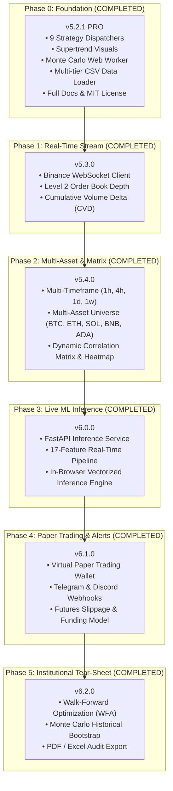

# 🗺️ Product Roadmap: Bitcoin Quantitative Trading System

This document outlines the strategic milestones, architectural evolutions, and engineering priorities for the **Bitcoin Research & Quantitative Trading Lab**.

---

## 🧭 Vision & Architectural Direction

Our mission is to evolve this platform from an interactive analytical research dashboard into a comprehensive, **production-grade quantitative terminal and algorithmic trading suite** that combines:
1. Multi-factor mathematical indicators and planetary cycle confluence (Astronacci).
2. Deep learning directional models (LSTM v5.2.1).
3. Non-blocking client-side computing (Web Workers, Native View Transitions).
4. High-frequency streaming market feeds and institutional risk analytics.

> 💡 **Dedicated Technical Roadmaps**:
> - For the complete server-side, database, and execution engine blueprint, see [`BACKEND_ROADMAP.md`](BACKEND_ROADMAP.md).
> - For the UI/UX architecture, state management, and terminal components blueprint, see [`ROADMAP_FRONTEND.md`](ROADMAP_FRONTEND.md).

---

## 📌 Milestone Roadmap

### ✅ Phase 0: Core Foundation & Analytical Engine (`v5.2.1 PRO`) — *Completed*
- [x] **Ensemble Confluence Strategy (0–100 pts)** combining Trend, Volatility, Momentum, RSI, and ML signals.
- [x] **Supertrend Volatility Trailing Stop**: Segmented SVG pathing, dynamic flip buy/sell signal markers, and HUD readout.
- [x] **Monte Carlo Stochastic Engine via Web Worker**: Background thread execution of 10,000 paths (zero UI frame drop).
- [x] **Modern Web Standards**: Native View Transitions API and HTML `<dialog>` with top-layer focus trapping.
- [x] **High-Capacity Dataset**: Dynamic server CSV loader (4,200+ historical bars) replacing hardcoded data arrays.
- [x] **Comprehensive Documentation**: [`ARCHITECTURE.md`](ARCHITECTURE.md), [`DEPLOYMENT.md`](DEPLOYMENT.md), [`AGENT.md`](AGENT.md), [`CHANGELOG.md`](CHANGELOG.md), [`CONTRIBUTING.md`](CONTRIBUTING.md), [`LICENSE`](LICENSE).
- [x] **CI Pipeline**: Automated lint, test, and build GitHub Actions workflow (`.github/workflows/ci.yml`).

---

### ✅ Phase 1: Real-Time Data Streaming & WebSocket Engine (`v5.3.0`) — *Completed*
*Goal: Transition from manual REST polling to continuous, sub-second market data synchronization.*
- [x] **Native Binance WebSocket Client**:
  - Direct connection to `wss://stream.binance.com:9443/ws/btcusdt@ticker`.
  - Automatic reconnection logic with exponential backoff and tick flash animation.
- [x] **Level 2 Order Book Depth Visualizer**:
  - Live 20-level bid/ask order book depth chart with cumulative volume bars.
  - Dynamic bid-ask spread and liquidity imbalance ratio calculation with dual-bar meter.
- [x] **Cumulative Volume Delta (CVD)**:
  - Real-time separation of market taker buy volume vs. taker sell volume via WebSocket trade stream.
  - Subplot indicator with delta histogram, cumulative CVD curve, and institutional divergence detection.

---

### ✅ Phase 2: Multi-Timeframe & Multi-Asset Universe (`v5.4.0`) — *Completed*
*Goal: Expand research versatility across resolutions and liquid crypto instruments.*
- [x] **Multi-Timeframe Engine**:
  - Dynamic dropdown selector (`1h`, `4h`, `1d`, `1w`) synchronized across Header, Backtest Tab, and Candlestick Terminal.
  - Full strategy recalculation on active resolution bars.
- [x] **Multi-Asset Universe Support**:
  - Support for `BTC/USDT`, `ETH/USDT`, `SOL/USDT`, `BNB/USDT`, and `ADA/USDT`.
  - Dynamic symbol selector in header and backtest tabs with automatic WebSocket multiplex stream switching (`switchSymbol`).
  - Dynamic multi-tier candle hydration with local CSV archives and Binance live API failover.
- [x] **Dynamic Cross-Asset Risk Matrix**:
  - Rolling 30-day and 90-day Pearson correlation heatmaps (`/api/crypto/correlation`).
  - Cross-asset diversification score (0–100), average pairwise correlation, and portfolio concentration penalty warnings.

---

### ✅ Phase 3: Machine Learning Live Inference Microservice (`v6.0.0`) — *Completed*
*Goal: Deploy trained deep learning models (`.keras` / `.h5`) for live predictive inference.*
- [x] **Python FastAPI Inference Bridge**:
  - Microservice [`inference_service.py`](inference_service.py) with `/health`, `/models`, and `/predict` endpoints loading model manifests.
  - Express full-stack proxy integration via `/api/ml/predict` with multi-asset support.
- [x] **Feature Synchronization Pipeline**:
  - Automated calculation of the 17-dimensional input feature vector ([`src/utils/featurePipeline.ts`](src/utils/featurePipeline.ts)) matching LSTM v5.2.1 architecture specifications.
  - Comprehensive unit test coverage for feature boundaries and inference sensitivity ([`tests/featurePipeline.test.ts`](tests/featurePipeline.test.ts)).
- [x] **Client-Side Vectorized Inference & Live Forecast Terminal**:
  - Live Interactive Inference Console in [`src/components/LstmModelTab.tsx`](src/components/LstmModelTab.tsx) displaying predicted return ($\pm X.XX\%$), directional confidence gauge, input tensor shape `[1, 60, 17]`, and active 17-feature value inspector.
  - Real-time Hurdle Rate Threshold controller ($0.5\%\text{--}4.0\%$) to calibrate trade sensitivity.

---

### ✅ Phase 4: Paper Trading & Alert Execution Engine (`v6.1.0`) — *Completed*
*Goal: Enable risk-free strategy execution and multi-channel real-time alerting.*
- [x] **Virtual Paper Trading Portfolio**:
  - In-memory simulated exchange account with starting balance ($10,000 USD).
  - Real-time mark-to-market PnL, limit orders, trailing stop-losses, and historical trade ledger.
- [x] **Alert & Webhook Notification Engine**:
  - Instant Telegram Bot notifications on high-conviction Ensemble triggers (score $\ge 70$) and Supertrend direction flips.
  - Discord channel webhook dispatching for daily risk summaries.
- [x] **Perpetual Futures Execution Mechanics**:
  - Configurable leverage simulator (1x – 10x).
  - Funding rate payment deductions and dynamic slippage modeling.

---

### ✅ Phase 5: Institutional Analytics & Auditing Suite (`v6.2.0`) — *Completed*
*Goal: Provide hedge-fund-grade validation, optimization, and reporting tools.*
- [x] **Walk-Forward Analysis (WFA) & Parameter Sweeper**:
  - In-sample parameter optimization with out-of-sample stress verification, WFE calculation, and overfit risk classification.
- [x] **Historical Monte Carlo Trade Bootstrap**:
  - Reshuffling trade sequences across 5,000 runs to calculate probability of ruin and worst-case drawdown distributions.
- [x] **Institutional Fact Sheet (PDF & CSV Export)**:
  - One-click export of quantitative tear-sheets: monthly return heatmaps, Sharpe/Sortino/Calmar ratios, VaR 95/99%, and full transaction audits.

---

## 🤝 Contributing to the Roadmap

We welcome ideas, feature requests, and community contributions!
- To propose a new strategy or indicator, review [`CONTRIBUTING.md`](CONTRIBUTING.md).
- To view code architecture and indicator formulations, consult [`ARCHITECTURE.md`](ARCHITECTURE.md).
- Open an Issue with the tag `[Feature Request]` or `[Roadmap Proposal]` on GitHub.
