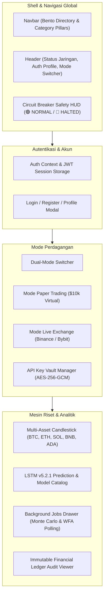

# 🎨 Frontend Roadmap: Bitcoin Quantitative Terminal & Trading Lab

Dokumen ini merupakan cetak biru arsitektur, evolusi UI/UX, dan rencana implementasi modul antarmuka pengguna (**Frontend React + Tailwind CSS + Vite**) untuk sistem trading kuantitatif.

Roadmap ini menjembatani seluruh kemampuan backend mutakhir (**Fase 1–5**) ke dalam antarmuka interaktif yang cepat, aman, dan intuitif.

---

## 🧭 Visi & Arah Desain Antarmuka

Tujuan utama roadmap frontend adalah mentransformasi platform dari sekadar visualisasi riset berbasis state lokal menjadi **Web-based Institutional Quantitative Terminal** yang mendukung:
1. **Multi-Tenancy & Autentikasi Pengguna**: Portofolio terisolasi per akun pengguna via JWT.
2. **Dual-Mode Execution (Paper vs Live)**: Transisi mulus antara simulasi Paper Trading dan eksekusi Live Exchange berotentikasi.
3. **Institutional Risk Telemetry**: Indikator Circuit Breaker real-time dan Emergency Panic Kill-Switch.
4. **Non-Blocking Heavy Computation**: Pelacakan progres asinkron (0–100%) untuk Monte Carlo 10k paths & Walk-Forward Optimization tanpa membekukan antarmuka.
5. **Audited Transparency**: Penampil buku besar finansial terenkripsi (*Immutable Ledger*) dengan verifikasi hash SHA-256.

---

## 🏗️ Diagram Alur & Arsitektur Frontend

---

## 📅 Rincian Milestone & Tahapan Pengerjaan

---

### 🟢 FASE 1: Autentikasi, Manajemen Sesi & Multi-User Shell (SELESAI ✅)

> **Target:** Mengintegrasikan endpoint `POST /api/auth/*` ke dalam aplikasi React, menyediakan modal pendaftaran/login, dan mengisolasi portofolio per user.

- [x] **1.1. Auth Context & JWT Interceptor (`src/context/AuthContext.tsx`)**
  - State manajemen pengguna global (`user`, `account`, `token`, `isAuthenticated`, `login`, `logout`, `register`, `authFetch`).
  - Penyimpanan token aman di `localStorage` (`quant_trading_jwt_token`) dengan verifikasi kedaluwarsa otomatis via `/api/auth/me`.
  - Fetch helper `authFetch` yang otomatis menyematkan header `Authorization: Bearer <token>`.
- [x] **1.2. Auth Modal Component (`src/components/auth/AuthModal.tsx`)**
  - Tampilan modal dialog interaktif dengan tabs: *Sign In* dan *Create Account*.
  - Validasi form real-time (format email, kekuatan password minimal 6 karakter, nama lengkap).
  - Indikator feedback kesalahan dan sukses yang responsif dengan animasi transisi halus.
- [x] **1.3. User Avatar & Profile HUD di Header (`src/components/Header.tsx`)**
  - Tombol *Sign In* dinamis di Header dengan gradasi amber-orange.
  - Avatar inisial, nama pengguna, dan badge role (`TRADER` / `ADMIN`) ketika terautentikasi.
  - Dropdown menu pengguna: ID pengguna, saldo ekuitas portofolio terisolasi (`userId`), dan tombol *Sign Out*.
  - Mode Tamu (*Guest Mode*) otomatis tetap aktif jika user belum login, mengarah ke `default_account` tanpa merusak fungsionalitas lain.

---

### 🟢 FASE 2: Live Exchange Management & AES Key Vault UI (SELESAI ✅)

> **Target:** Menyediakan antarmuka pengelolaan API Key bursa (Binance & Bybit) terenkripsi dan toggle transisi antara Paper Trading dan Live Trading.

- [x] **2.1. API Key Vault Manager (`src/components/vault/ApiKeyVaultModal.tsx` & `src/services/exchangeApi.ts`)**
  - Form input API Key, Secret Key, dan Passphrase (OKX) dengan toggle intip rahasia (*Show/Hide*).
  - Pilihan bursa (*Binance Futures*, *Bybit USDT*, *OKX v5*) dan toggle *Testnet* vs *Mainnet*.
  - Tabel kredensial tersimpan dengan tampilan *Masked Key* (`d942...0a1c`) dan aksi hapus API Key (`DELETE /api/exchange/keys/:id`).
  - Tombol **"Test Connection"**: Menampilkan latensi koneksi real-time (`⚡ 38ms`) dan verifikasi kredensial bursa live.
- [x] **2.2. Mode Perdagangan Switcher (Paper vs Live) di Header (`src/components/Header.tsx`)**
  - Toggle visual segmented di Header: `[ 🧪 PAPER ]` vs `[ ⚡ LIVE ]`.
  - Tombol akses cepat ke Key Vault langsung dari Header.
  - Banner peringatan visual merah/amber aktif saat beralih ke Live Trading untuk mencegah kekeliruan eksekusi order modal nyata.
- [x] **2.3. Eksekusi Order Live Berotentikasi (`src/components/vault/LiveOrderConfirmModal.tsx` & `src/components/PaperTradingTab.tsx`)**
  - Sambungan form order book ke endpoint `POST /api/exchange/order` menggunakan API Key tersimpan.
  - Dialog pop-up konfirmasi ganda (*Double-Confirmation Modal*) menampilkan ringkasan trading pair, side, notional USD, leverage, estimasi margin, dan pemberitahuan risiko sebelum pengiriman *signed request* ke matching engine bursa.

---

### 🟢 FASE 3: Institutional Circuit Breaker HUD & Emergency Controls (SELESAI ✅)

> **Target:** Membawa sistem proteksi modal institusional (Fase 5 Backend) langsung ke pandangan mata trader (*HUD*) dengan tombol darurat satu-klik.

- [x] **3.1. Circuit Breaker Telemetry Pill di Header (`src/components/Header.tsx`)**
  - Badge dinamis: `🟢 CB: NORMAL`, `🟡 CB: WARNING`, atau `🔴 CB: HALTED` dengan animasi ping real-time.
  - Banner peringatan darurat merah mencolok saat status `HALTED` aktif dengan pesan alasan pembekuan sistem.
- [x] **3.2. Emergency Panic Kill-Switch Button (`src/components/circuitBreaker/CircuitBreakerModal.tsx`)**
  - Panel kontrol darurat dengan telemetri: Drawdown 1 Jam (Max 5%), Drawdown Harian (Max 10%), dan Ambang Kerugian Beruntun (Max 3).
  - Tombol darurat merah **"Trigger Panic Kill-Switch"** dengan modal konfirmasi bertingkat dan input alasan (*tagging*).
  - Memanggil `POST /api/exchange/circuit-breaker/kill`: membatalkan seluruh order pending, melikuidasi posisi aktif di market price, dan mengunci perdagangan.
- [x] **3.3. Admin Recovery & Reset Modal (`src/services/exchangeApi.ts`)**
  - Tombol **"Reset Circuit Breaker"** memanggil `POST /api/exchange/circuit-breaker/reset` untuk memulihkan status ke `NORMAL` dan mengaktifkan kembali trading.
  - Polling telemetri risiko otomatis setiap 15 detik di [src/App.tsx](file:///mnt/data/BACK_UP/Code/Quant_Trading_System/src/App.tsx).

---

### 🟢 FASE 4: Asynchronous Computing Drawer & Progress Hub (SELESAI ✅)

> **Target:** Mengubah eksekusi Monte Carlo 10,000 paths dan Walk-Forward Optimization yang berat menjadi pekerjaan asinkron di latar belakang dengan progress bar visual.

- [x] **4.1. Background Task Floating Drawer / Notification Widget (`src/components/jobs/JobProgressDrawer.tsx`)**
  - Widget mengambang di pojok kanan bawah yang memantau pekerjaan asinkron yang sedang berjalan.
  - Polling otomatis ke `GET /api/jobs/:id/status` secara cerdas (1.5s saat aktif).
  - Bilah kemajuan real-time (0% ➔ 30% ➔ 70% ➔ 100%), tombol pembatalan (`cancelJobApi`), dan inspeksi hasil JSON.
- [x] **4.2. Asynchronous Monte Carlo Modal Integration (`src/components/MonteCarloTab.tsx` & `src/services/jobApi.ts`)**
  - Mengirim parameter simulasi ke `POST /api/jobs/monte-carlo`.
  - Tombol **"Async 10k Paths"** di tab Monte Carlo yang mendispatch pekerjaan ke backend worker tanpa membekukan thread utama UI browser.
- [x] **4.3. Walk-Forward Candidate Sweep Progress & Quick Dispatch**
  - Quick action shortcut di Drawer untuk meluncurkan simulasi Monte Carlo 10k paths dan WFA sweep.
  - Pelacakan durasi komputasi dan metrik ringkasan (*Median Price*, *VaR 95%*, *CVaR 95%*, dan *Sharpe Ratio*).

---

### 🟢 FASE 5: Multi-Asset Selector & Immutable Ledger Audit Viewer (SELESAI ✅)

> **Target:** Membuka seluruh aset crypto yang telah di-seed di MongoDB Atlas dan menyediakan transparansi audit buku besar keuangan terenkripsi.

- [x] **5.1. Multi-Asset Candlestick Selector (`src/components/Header.tsx` & `src/App.tsx`)**
  - Pemilihan multi-aset terpadu di Header: `BTC`, `ETH`, `SOL`, `BNB`, `ADA`.
  - Sinkronisasi instan terhadap WebSocket ticker stream, historical dynamic dataset, dan tab order placement.
- [x] **5.2. Penampil Buku Besar Keuangan (Immutable Ledger Table & Audit Viewer)**
  - Komponen modal audit buku besar finansial: `src/components/ledger/LedgerAuditModal.tsx` & service `src/services/ledgerApi.ts`.
  - Tabel kronologis transaksi: Waktu, Jenis (`INITIAL_DEPOSIT`, `TRADE_PROFIT`, `TRADE_LOSS`, `FEE_DEDUCTION`, `FUNDING_PAYMENT`, `ORDER_MARGIN_LOCK`), Jumlah ($), Saldo Sebelum ➔ Sesudah, dan tautan hash SHA-256 (`prevHash` ➔ `hash`).
  - Tombol **"Audit Cryptographic Chain"**: Memvalidasi seluruh urutan hash SHA-256 secara langsung di depan mata trader (`GET /api/paper/ledger/verify/:accountId`).
  - Terintegrasi di action bar Paper Trading dan User Profile menu di Header.
- [x] **5.3. Performance Optimization & Lazy Loading (`src/App.tsx`)**
  - Pemisahan kode (*code-splitting*) menggunakan `React.lazy()` dan `Suspense` untuk 8 modul komputasi berat (`BacktestTab`, `RiskManagementTab`, `MonteCarloTab`, `LstmModelTab`, `PortfolioTab`, `AstroCycleTab`, `ModulesTab`, `GridTradingTab`).
  - Main bundle berkurang dari ~636 kB menjadi **413 kB** (dibawah batas 500 kB tanpa warning Vite sama sekali), dengan 8 dynamic chunks terpisah.

---

## 📊 Matriks Prioritas & Estimasi Pengerjaan Frontend

| Fase | Inisiatif Frontend | Estimasi Waktu | Dampak User | Status |
| :---: | :--- | :---: | :---: | :---: |
| **Fase 1** | Auth Context, JWT Storage & Login/Register Modal | 1-2 sesi | Tinggi | ✅ Selesai |
| **Fase 2** | API Key Vault Manager (AES) & Dual-Mode Switcher | 1-2 sesi | Kritis | ✅ Selesai |
| **Fase 3** | Circuit Breaker HUD & Emergency Panic Kill-Switch | 1 sesi | Kritis | ✅ Selesai |
| **Fase 4** | Async Background Jobs Drawer & 0-100% Progress Bar | 1-2 sesi | Tinggi | ✅ Selesai |
| **Fase 5** | Multi-Asset Universe & Immutable Ledger Audit Table | 1-2 sesi | Menengah | ✅ Selesai |

---

## 🏆 Status Pencapaian Roadmap
**SELURUH FASE FRONTEND (FASE 1–5) DAN BACKEND (FASE 1–5) TELAH LENGKAP 100% DIKERJAKAN, TERUJI DENGAN 120 AUTOMATED TESTS PASSING, DAN DI-PUSH KE REPOSITORY.**
