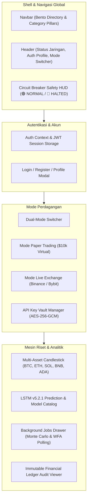

# 🎨 Frontend Roadmap: Bitcoin Quantitative Terminal & Trading Lab

Dokumen ini merupakan cetak biru arsitektur, evolusi UI/UX, dan rencana implementasi modul antarmuka pengguna (**Frontend React + Tailwind CSS + Vite**) untuk sistem trading kuantitatif.

Roadmap ini menjembatani seluruh kemampuan backend mutakhir (**Fase 1–5**) ke dalam antarmuka interaktif yang cepat, aman, dan intuitif.

---

## 🧭 Visi & Arah Desain Antarmuka

Tujuan utama roadmap frontend adalah mentransformasi platform dari sekadar visualisasi riset berbasis state lokal menjadi **Web-based Institutional Quantitative Terminal** yang mendukung:
1. **Multi-Tenancy & Autentikasi Pengguna**: Portofolio terisolasi per akun pengguna via JWT.
2. **Dual-Mode Execution (Paper vs Live)**: Transisi mulus antara simulasi Paper Trading dan eksekusi Live Exchange berotentikasi.
3. **Institutional Risk Telemetry**: Indikator Circuit Breaker real-time dan Emergency Panic Kill-Switch.
4. **Non-Blocking Heavy Computation**: Pelacakan progres asinkron (0–100%) untuk Monte Carlo 10k paths & Walk-Forward Optimization tanpa membekukan antarmuka.
5. **Audited Transparency**: Penampil buku besar finansial terenkripsi (*Immutable Ledger*) dengan verifikasi hash SHA-256.

---

## 🏗️ Diagram Alur & Arsitektur Frontend

---

## 📅 Rincian Milestone & Tahapan Pengerjaan

---

### 🟢 FASE 1: Autentikasi, Manajemen Sesi & Multi-User Shell (SELESAI ✅)

> **Target:** Mengintegrasikan endpoint `POST /api/auth/*` ke dalam aplikasi React, menyediakan modal pendaftaran/login, dan mengisolasi portofolio per user.

- [x] **1.1. Auth Context & JWT Interceptor (`src/context/AuthContext.tsx`)**
  - State manajemen pengguna global (`user`, `account`, `token`, `isAuthenticated`, `login`, `logout`, `register`, `authFetch`).
  - Penyimpanan token aman di `localStorage` (`quant_trading_jwt_token`) dengan verifikasi kedaluwarsa otomatis via `/api/auth/me`.
  - Fetch helper `authFetch` yang otomatis menyematkan header `Authorization: Bearer <token>`.
- [x] **1.2. Auth Modal Component (`src/components/auth/AuthModal.tsx`)**
  - Tampilan modal dialog interaktif dengan tabs: *Sign In* dan *Create Account*.
  - Validasi form real-time (format email, kekuatan password minimal 6 karakter, nama lengkap).
  - Indikator feedback kesalahan dan sukses yang responsif dengan animasi transisi halus.
- [x] **1.3. User Avatar & Profile HUD di Header (`src/components/Header.tsx`)**
  - Tombol *Sign In* dinamis di Header dengan gradasi amber-orange.
  - Avatar inisial, nama pengguna, dan badge role (`TRADER` / `ADMIN`) ketika terautentikasi.
  - Dropdown menu pengguna: ID pengguna, saldo ekuitas portofolio terisolasi (`userId`), dan tombol *Sign Out*.
  - Mode Tamu (*Guest Mode*) otomatis tetap aktif jika user belum login, mengarah ke `default_account` tanpa merusak fungsionalitas lain.

---

### 🟡 FASE 2: Live Exchange Management & AES Key Vault UI

> **Target:** Menyediakan antarmuka pengelolaan API Key bursa (Binance & Bybit) terenkripsi dan toggle transisi antara Paper Trading dan Live Trading.

- [ ] **2.1. API Key Vault Manager (`src/components/vault/ApiKeyVaultModal.tsx`)**
  - Form input API Key, Secret Key, dan Passphrase (OKX).
  - Pilihan bursa (*Binance Futures*, *Bybit*) dan toggle *Testnet* vs *Mainnet*.
  - Tabel kredensial tersimpan dengan tampilan *Masked Key* (`f482...a482`) dan tombol hapus.
  - Tombol **"Test Connection"**: Menampilkan latensi koneksi (misal `⚡ 42ms`) dan status validasi API bursa secara live.
- [ ] **2.2. Mode Perdagangan Switcher (Paper vs Live)**
  - Toggle visual jelas di Header: `[ 🧪 PAPER TRADING ]` vs `[ ⚡ LIVE EXCHANGE ]`.
  - Peringatan visual bergaris kuning/merah saat beralih ke Live Trading untuk mencegah kekeliruan eksekusi order modal nyata.
- [ ] **2.3. Eksekusi Order Live Berotentikasi**
  - Sambungan form order book ke endpoint `POST /api/exchange/order`.
  - Modal konfirmasi order sebelum pengiriman live signed request ke bursa.

---

### 🔴 FASE 3: Institutional Circuit Breaker HUD & Emergency Controls

> **Target:** Membawa sistem proteksi modal institusional (Fase 5 Backend) langsung ke pandangan mata trader (*HUD*) dengan tombol darurat satu-klik.

- [ ] **3.1. Circuit Breaker Telemetry Pill di Header**
  - Badge dinamis: `🟢 CIRCUIT BREAKER: NORMAL` atau `🔴 HALTED: DRAWDOWN LIMIT REACHED`.
  - Tooltip interaktif menampilkan drawdown 1 jam saat ini (misal `Drawdown: 1.8% / Max: 5.0%`).
- [ ] **3.2. Emergency Panic Kill-Switch Button**
  - Tombol darurat merah bertuliskan **"EMERGENCY KILL-SWITCH"** di Header atau bilah atas dashboard.
  - Modal konfirmasi cepat bertingkat untuk mencegah klik tidak sengaja.
  - Ketika dipicu, memanggil `POST /api/exchange/circuit-breaker/kill`: seketika membatalkan semua order pending, menutup seluruh posisi aktif di market price, dan mengunci perdagangan.
- [ ] **3.3. Admin Recovery & Reset Modal**
  - Jika sistem dalam status `HALTED`, seluruh form trading dinonaktifkan (*disabled*) dengan banner peringatan.
  - Tombol **"Reset Circuit Breaker"** untuk memulihkan mode normal setelah situasi darurat teratasi (`POST /api/exchange/circuit-breaker/reset`).

---

### 🟣 FASE 4: Asynchronous Computing Drawer & Progress Hub

> **Target:** Mengubah eksekusi Monte Carlo 10,000 paths dan Walk-Forward Optimization yang berat menjadi pekerjaan asinkron di latar belakang dengan progress bar visual.

- [ ] **4.1. Background Task Floating Drawer / Notification Widget**
  - Widget mengambang di pojok kanan bawah yang memantau pekerjaan asinkron yang sedang berjalan.
  - Polling otomatis ke `GET /api/jobs/:id/status` setiap 1–2 detik.
  - Bilah kemajuan real-time (0% ➔ 30% ➔ 70% ➔ 100%).
- [ ] **4.2. Asynchronous Monte Carlo Modal Integration**
  - Mengirim parameter simulasi ke `POST /api/jobs/monte-carlo`.
  - Tidak memblokir tab browser; pengguna dapat bebas berpindah ke chart atau paper trading saat simulasi 10k paths dihitung di backend.
  - Ketika selesai, notifikasi muncul dan kurva probabilitas (P5, P25, P50, P75, P95) langsung di-render ke chart.
- [ ] **4.3. Walk-Forward Candidate Sweep Progress**
  - Pelacakan iterasi candidate parameter sweep secara bertahap.
  - Menampilkan metrik in-sample vs out-of-sample seketika setelah job selesai.

---

### 🔵 FASE 5: Multi-Asset Selector & Immutable Ledger Audit Viewer

> **Target:** Membuka seluruh aset crypto yang telah di-seed di MongoDB Atlas dan menyediakan transparansi audit buku besar keuangan terenkripsi.

- [ ] **5.1. Multi-Asset Candlestick Selector**
  - Dropdown pemilihan aset di atas chart: `BTC/USDT`, `ETH/USDT`, `SOL/USDT`, `BNB/USDT`, `ADA/USDT`.
  - Pengambilan data otomatis dari endpoint backend `GET /api/crypto/candles?symbol=ETH&interval=1h` dengan fast-tier caching.
  - Mini statistik 24 jam (Volume, 24h Change, High, Low) terupdate real-time.
- [ ] **5.2. Penampil Buku Besar Keuangan (Immutable Ledger Table)**
  - Tab baru atau modal di Paper Trading: **"Financial Ledger & Audit Trail"**.
  - Tabel kronologis transaksi: Waktu, Jenis (`INITIAL_DEPOSIT`, `FEE_DEDUCTION`, `POSITION_CLOSE`, `FUNDING_PAYMENT`), Jumlah ($), Saldo Sebelum, Saldo Sesudah.
  - Badge verifikasi kriptografi: Menampilkan status integritas rantai hash (`GET /api/paper/ledger/verify/:accountId`).
  - Tombol **"Audit Cryptographic Chain"**: Memvalidasi seluruh urutan hash SHA-256 secara langsung di depan mata pengguna.
- [ ] **5.3. Performance Optimization & Lazy Loading**
  - Pemisahan kode (*code-splitting*) menggunakan `React.lazy()` dan `Suspense` untuk tab-tab analitik berat (`MonteCarloTab`, `BacktestTab`, `AstroCycleTab`).
  - Reduksi ukuran bundle awal agar initial page load sub-1 detik.

---

## 📊 Matriks Prioritas & Estimasi Pengerjaan Frontend

| Fase | Inisiatif Frontend | Estimasi Waktu | Dampak User | Status |
| :---: | :--- | :---: | :---: | :---: |
| **Fase 1** | Auth Context, JWT Storage & Login/Register Modal | 1-2 sesi | Tinggi | ✅ Selesai |
| **Fase 2** | API Key Vault Manager (AES) & Dual-Mode Switcher | 1-2 sesi | Kritis | ⏳ Antrean |
| **Fase 3** | Circuit Breaker HUD & Emergency Panic Kill-Switch | 1 sesi | Kritis | ⏳ Antrean |
| **Fase 4** | Async Background Jobs Drawer & 0-100% Progress Bar | 1-2 sesi | Tinggi | ⏳ Antrean |
| **Fase 5** | Multi-Asset Universe & Immutable Ledger Audit Table | 1-2 sesi | Menengah | ⏳ Antrean |

---

## 🛠️ Rekomendasi Urutan Pengerjaan Pertama:
1. **Langkah 1**: Kerjakan **Fase 1 (AuthContext & Login/Register Modal)** agar seluruh pengguna memiliki identitas terisolasi.
2. **Langkah 2**: Lanjutkan ke **Fase 2 (API Key Vault & Dual-Mode Switcher)** dan **Fase 3 (Circuit Breaker HUD)** untuk keselamatan perdagangan.
